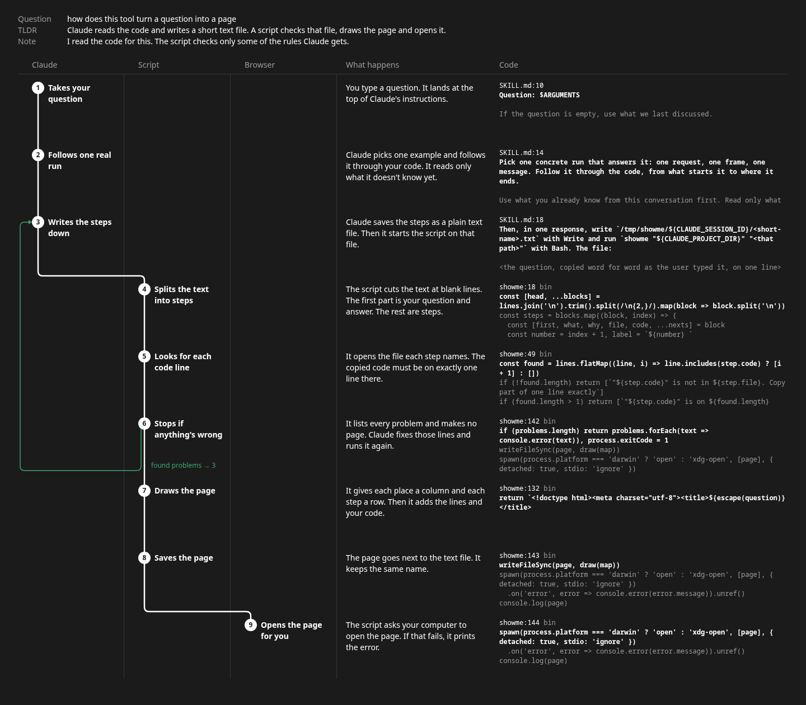

# showme

A Claude Code plugin that draws how something in your project works, on one page.

You ask `/showme how does login work?`. Claude reads the code and opens a page in your browser. The page follows one real run, step by step, with the code beside each step.



## Install

In Claude Code:

```
/plugin marketplace add rh-stack/showme
/plugin install showme@showme
```

Start a new session after the install.

You need Node 22.7 or later, Linux or macOS, and a desktop browser.

## Use

```
/showme how does an uploaded image get saved?
/showme gmail vs outlook, what's the difference
/showme
```

With no question, it draws what you last talked about. To ask more about a page, name a step in the terminal: "why 7 to 4?".

## Read the page

- A column is a place, such as a browser or a server.
- A row is a step. Time goes down.
- The thick line is the run.
- A green line is a jump, such as a retry.
- Steps with no line are separate items, for lists and comparisons.

## What it checks

A small script checks that each quoted line exists in your code. It can't check that a sentence is true. Claude writes the sentences, so compare them with the code on the same row.

## Limits

A page has at most 9 steps and 4 places.

Pages go to `/tmp/showme`, and the script does not write to your project. Pages make no network requests. Claude reads your code the way it does in any session.

## License

GPL-3.0
